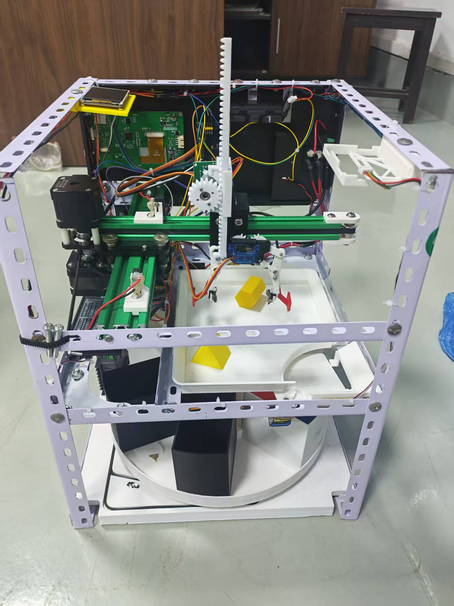
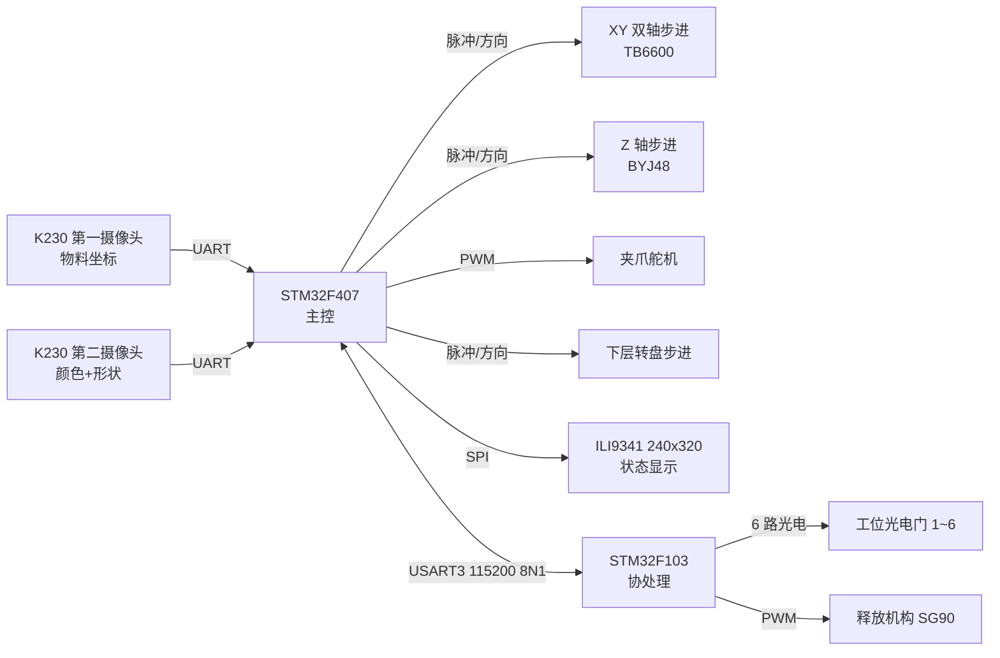

# 智能物料分拣系统（STM32F407 + STM32F103 双板方案）

基于 **STM32F407ZGT6 主控 + STM32F103C8T6 协处理** 的自动物料分拣装置。K230 视觉模组识别物料的**颜色与形状**，三轴步进 + 舵机夹爪完成定位抓取，六工位转盘按类别自动分类入库，TFT 屏实时显示识别结果与计数。全部代码为裸机 C（HAL 标准外设库风格），Keil MDK 工程可直接编译烧录。

---

## 实物展示

<p align="center">
  
</p>

<p align="center">
  <em>整机实物：铝合金型材框架 / 双 K230 摄像头 / 三轴步进 + 齿条 Z 轴 / 舵机夹爪 / 六工位分类转盘</em>
</p>

---

## 系统架构



| 板卡 | 职责 |
| --- | --- |
| **F407（主控）** | 主分拣流程调度、XY/Z 轴运动、夹爪舵机、转盘定位、双摄像头串口解析、屏幕刷新、与 F103 通信 |
| **F103（协处理）** | 6 路工位光电门实时采集上报（10 ms 周期）、释放机构舵机时序动作、向 F407 回复 ACK/DONE |

## 功能特性

- **视觉双相机方案**：第一相机给出物料 XY 坐标与是否为正方体/圆柱；第二相机给出颜色（红/黑/黄/深蓝/浅蓝/橙/绿）与形状（1~7）。
- **按 (颜色, 形状) 组合分类**：类别编码 `color * 8 + shape`，映射到 6 个分类工位，同类别自动复用同一盒位。
- **分形状自适应抓取策略**：正方体、圆柱、其他长方体分别使用独立的 Z 轴下探深度、分段闭合角度与速度曲线，避免夹爪空夹或压坏物料。
- **上电自动回零**：XY 双轴光电限位回零 + 下层转盘回零到 1 号工位，回零期间并行预取视觉结果，缩短节拍。
- **批量连续作业**：一次按键后循环分拣，直到第一相机返回无物料为止。
- **通信可靠性**：释放动作采用 `RELEASE → ACK → DONE` 三步握手，带 3 s 超时保护；超时结束本轮而非死锁。
- **实时显示**：240×320 TFT 显示识别颜色/形状、当前目标工位与各类计数。

## 硬件配置

| 部件 | 型号 / 说明 |
| --- | --- |
| 主控 | STM32F407ZGT6（168 MHz） |
| 协处理 | STM32F103C8T6 |
| 视觉 | K230 模组 × 2（串口输出） |
| XY 驱动 | TB6600 细分驱动器 × 2 |
| Z 轴 | 24BYJ48 减速步进 + 驱动 |
| 下层转盘 | 步进电机 + TB6600 |
| 夹爪 | 总线/ PWM 舵机 |
| 释放机构 | SG90 舵机（F103 控制，PA1） |
| 显示 | ILI9341 240×320（软件 SPI） |
| 工位检测 | 6 路槽型光电门（F103 PB3~PB8） |

> 完整接线见根目录 `智能分拣系统接线汇总.xlsx`，双板联调细节见 `双板通信测试说明.md`。

## 目录结构

```
.
├── F407程序/            # 主控工程（Keil: Project.uvprojx）
│   ├── User/            # main.c 主流程、中断
│   ├── System/          # TB6600 / ZStepper / GripperServo / VisionUART /
│   │                    # ObjectUART / BoardUART / ILI9341 / ScreenTable 等
│   ├── Library/         # STM32F4 标准外设库
│   └── Start/           # 启动文件
├── F103程序/            # 协处理工程（Keil: Project.uvprojx）
│   ├── User/            # main.c 光电采集 + 释放时序
│   ├── Hardware/        # Servo / PWM / OLED / Key / LED
│   ├── Library/         # STM32F10x 标准外设库
│   └── Start/
├── 装置零件建模/        # SolidWorks 零件源文件（.SLDPRT）+ 切片文件（.3mf）
├── docs/images/         # README 配图
└── 分拣项目.code-workspace
```

## 工作流程

1. 上电：F103 先启动并开始上报传感器状态；F407 完成下层转盘回零、XY 回零。
2. 按下启动键（PC7）：F407 请求第一相机获取物料坐标。
3. 移动到物料上方 → 按识别形状选择抓取参数 → 下探、闭合、抬升。
4. 移动到放料点 → 张开夹爪 → 500 ms 后请求第二相机识别颜色与形状。
5. 移动到待机点（X=6.5 cm, Y=0），等待第二相机结果。
6. 按类别计算目标工位 → 下层转盘转动至对应光电门 → 发送 `RELEASE`。
7. F103 执行释放动作并回 `DONE` → F407 更新计数与屏幕 → 返回步骤 2。
8. 第一相机返回无物料时结束批量流程，等待下一次按键。

## 通信协议（F407 USART3 ↔ F103 USART1）

| 方向 | 报文 | 含义 |
| --- | --- | --- |
| F103 → F407 | `SENSOR:XX` | 6 位光电门掩码（十六进制，bit0=工位 1） |
| F407 → F103 | `RELEASE\r\n` | 请求释放 |
| F103 → F407 | `ACK\r\n` | 已接收 |
| F103 → F407 | `DONE\r\n` | 舵机时序动作完成 |
| F103 → F407 | `ERR\r\n` | 无效指令 |

串口参数：115200, 8N1。F407 侧最长等待 3000 ms。

## 编译与烧录

使用 **Keil MDK 5**：

1. 打开 `F407程序/Project.uvprojx`，编译后下载到 F407。
2. 打开 `F103程序/Project.uvprojx`，编译后下载到 F103。

> ⚠️ 两个工程必须分别下载到对应芯片，**不可交叉烧录**。请先给 F103 上电/复位，再启动 F407。

## 关键参数位置

调参集中在 `F407程序/User/main.c` 顶部的宏定义：

- `Z_*_DOWN_STEPS` / `Z_*_LIFT_STEPS`：各形状 Z 轴行程（按 427 步 ≈ 1 cm 换算）
- `Z_STEP_INTERVAL_US` / `Z_LIFT_INTERVAL_US`：下降 / 抬升速度
- `STEPS_PER_MM_X/Y_NUM`：XY 每毫米脉冲数（当前 156.86 pulse/mm）
- `MOVE_SPEED_HZ` / `HOME_SPEED_HZ`：XY 运动与回零频率
- `PLACE_X/Y_CENTI_MM`：放料点绝对坐标
- `SHAPE_GATE_COUNT`：分类盒数量（当前 6，修改需同步 `Shape_Gate[]` 与屏幕布局）
- `LOWER_MOTOR_TEST_ONE_REV` / `LOWER_SENSOR_SEQUENCE_TEST`：调试用测试开关，正常作业请保持 `0`

## 注意事项

- 首次上电务必**空载**验证 Z 轴行程与夹爪角度，避免堵转或压坏物料。
- 舵机需独立供电并与主控共地，不要从 GPIO 取电。
- 光电门默认**低电平有效**（遮挡 = 0），采用上拉输入；PB3/PB4 需关闭 JTAG 保留 SWD。
- 仓库中不含 `Backup_*` / `备份_*` 历史快照与编译产物，详见 `.gitignore`。

## 开发环境

- Keil MDK-ARM 5.x（ARMCC）
- STM32F4xx / STM32F10x Standard Peripheral Library
- VS Code + C/C++ 扩展（多根工作区：`分拣项目.code-workspace`）

---

本项目为大学生工程实践创新项目（工创项目）作品，欢迎交流指正。
